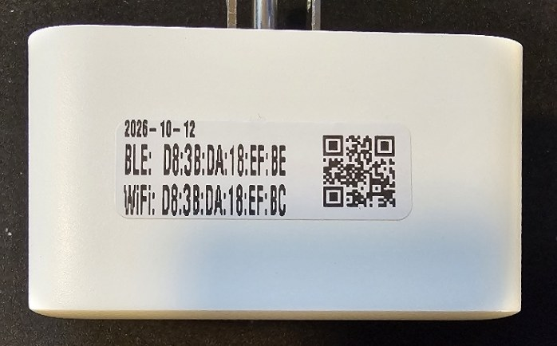

# Switchback

**SwitchBot Plug Mini to ESPHome. No app, no cloud, one exe.**



### [Download switchback.exe](https://github.com/ChristopherGriffin/switchback/releases/latest/download/switchback.exe)

Windows, one file, always the latest version. Older versions and checksums are on the [Releases page](https://github.com/ChristopherGriffin/switchback/releases). Then follow [the easy way](#the-easy-way-switchbackexe) below.

Switchback replaces the stock firmware on the SwitchBot Plug Mini with [ESPHome](https://esphome.io), over Wi-Fi, without opening the case and **without the SwitchBot app**. It works on the W1901400 and the HomeKit W1901401. Both are the same ESP32-C3 hardware.

It is a fork of [kendallgoto/switchbota](https://github.com/kendallgoto/switchbota). The original puts Tasmota 11.1 on the plug and you move to ESPHome from there, and it needs the SwitchBot app to get the plug online first. This fork writes ESPHome directly and sets the plug's Wi-Fi itself over Bluetooth, so there is no app, no phone, and no SwitchBot account in the loop. It ships as a single Windows program.

## Read this first

**This is early.** Treat your first plug as an experiment.

The process overwrites the plug's bootloader over Wi-Fi. If the plug loses power at the wrong moment, or is written with something broken, it is bricked. These plugs are welded shut, so recovery means cutting the case open and flashing over the serial pads. Do not unplug or bump a plug while it is converting. Try one plug before you do a box of them.

This is a proof of concept and comes with no warranty.

## What you need

- A SwitchBot Plug Mini (W1901400 or W1901401), out of the box. The SwitchBot app is **not** needed.
- A Windows PC with Bluetooth.
- One network change so the plug fetches our firmware instead of SwitchBot's: your DNS has to send `wohand.com` to the PC. The program checks this for you and tells you exactly what to do. It is the one thing people get stuck on, so it has its own section below.
- The plug and the PC do not have to be on the same subnet, but the plug has to be able to reach the PC.

## How it works

1. The program sets the plug's Wi-Fi over Bluetooth (this is the part that used to need the app).
2. A small server on the PC stands in for SwitchBot's update server. Your DNS points the plug at it.
3. A Bluetooth command tells the plug to update. It fetches a tiny flasher from the PC, then the ESPHome image, and writes it over itself.
4. The plug reboots into ESPHome and appears on your network as `sbplug-xxxxxx`.

## The easy way: switchback.exe

One file, nothing to install. No git, no Node, no Python, no ESPHome.

1. **[Download switchback.exe](https://github.com/ChristopherGriffin/switchback/releases/latest/download/switchback.exe)** (the latest version; older ones are on the [Releases page](https://github.com/ChristopherGriffin/switchback/releases)).
2. Set up DNS so `wohand.com` points at this PC (see the next section). You only do this once.
3. Plug in a SwitchBot Plug Mini near the PC and run `switchback.exe`.

It will:

- check DNS and, if it is not pointed here yet, tell you how to fix it,
- ask **which Wi-Fi the plug should join**, and the password,
- ask **direct or portal**:
  - **direct** - the plug comes up on the Wi-Fi you just typed. Simplest.
  - **portal** - after flashing, the plug opens its own `sbplug-xxxxxx` hotspot and you pick the Wi-Fi in a browser. Use this if the network you flash over is not the plug's final home.
- find the plug over Bluetooth, set its Wi-Fi, and flash it to ESPHome.

The first run shows a one-time Windows Firewall prompt (it needs to serve on the network). Allow it. The program is not code-signed, so Windows SmartScreen may say "unknown publisher"; click "More info" then "Run anyway".

It writes `sbplug_flashed.txt` next to itself: a numbered list of every plug done, with both MAC addresses. Point it at a ZPL label printer with `--printer host:9100` and each plug also gets a label like the one in the photo above (sized for 1.5 x 0.5 inch labels): the date, both MACs, and a QR code of both.

If a plug does not convert, it is unharmed as long as it still shows up in a Bluetooth scan. Leave it powered and run again.

## Point your plugs' DNS at the PC

The plug looks up `wohand.com` to get its firmware. You make that name resolve to the PC running `switchback.exe` instead of to SwitchBot. The program checks this at startup and prints the fix if it is not set. Pick whichever you can do:

- **Your router (simplest).** Set the router's DHCP "DNS server" to the PC's address. `switchback.exe` runs a DNS server, so every other name still resolves normally; only `wohand.com` is redirected.
- **Just the plugs' network / VLAN.** If the plugs are on their own network, set that network's DNS server to the PC's address.
- **Your own DNS (Pi-hole, AdGuard Home, Technitium, pfSense).** Add records sending `wohand.com` and `www.wohand.com` to the PC's address.

To check from another device:

```
nslookup www.wohand.com
```

It should answer with the PC's address.

## After the plug is on ESPHome

The flashed image is a small bootstrap: it gets the plug on Wi-Fi and leaves it open to ESPHome's over-the-air updates (OTA password `switchbota`, change it when you flash your own config). Adopt it in ESPHome or Home Assistant and push your real configuration over OTA. A full config for this hardware (relay, button, power monitoring, LEDs) is in [esphome-miniplug-framework](https://github.com/ChristopherGriffin/esphome-miniplug-framework).

The button: a short press toggles the relay, and holding it for 10 seconds factory resets. On a portal plug, a reset sends it back to its hotspot.

## Power users: from the repo

If you want to build the firmware yourself or script a batch, clone the repo and use the Python tools. You need Python 3.10 to 3.13 with ESPHome (`pip install esphome`), plus `bleak` and `zeroconf` (`pip install bleak zeroconf`).

```
git clone -b esphome-direct https://github.com/ChristopherGriffin/switchback.git
cd switchback
```

- Build a payload: `python tools/build_payload.py portal` (or `implant` to bake your own Wi-Fi in from `esphome/secrets.yaml`, or `direct` for the patchable image the exe uses).
- Run the all-in-one tool (server + DNS + Bluetooth flasher):
  `python tools/switchback.py` and answer the prompts, the same flow as the exe.
- Just the Bluetooth flasher against a server elsewhere:
  `python tools/sbplug_batch.py --server http://<server> --wifi-ssid "<name>" --wifi-pass "<pw>"`

On Windows there is also `switchback.ps1`, which sets up the Python environment and runs the tool for you.

## A dedicated always-on server

To keep the firmware server up on a Linux box (a Pi, a NUC, a VM) instead of the PC, use the installer. On Debian or Ubuntu:

```
git clone -b esphome-direct https://github.com/ChristopherGriffin/switchback.git
sudo sh switchback/server/install.sh
sudo sh switchback/server/install.sh build portal
```

It installs Docker if needed, builds the image, and runs the server. Point your DNS at that box, then run the Bluetooth flasher from any computer with Bluetooth:

```
python tools/sbplug_batch.py --server http://<that box's address> --wifi-ssid "<name>" --wifi-pass "<pw>"
```

## If something goes wrong

- **The plug never fetches firmware.** Its DNS is not reaching the server. Run `nslookup www.wohand.com` from a device on the plug's network, and check the plug can reach the PC on port 80.
- **A port is busy.** Something else on the PC is using port 80 or 53. Close it, or use the dedicated-server path on another box.
- **The plug is not found over Bluetooth.** Make sure it is powered and nearby and the PC's Bluetooth is on. A plug already converted no longer shows up as a SwitchBot device.
- **A plug got stuck mid-convert.** As long as it still appears in a Bluetooth scan it is still on stock firmware and fine. Run it again.
- **It is actually bricked.** It stopped responding during the write. Recovery is opening the case and flashing over the four serial pads inside.

## Credits

Fork of [kendallgoto/switchbota](https://github.com/kendallgoto/switchbota). The original reverse engineering of the OTA and BLE update process is theirs. This fork adds the direct-to-ESPHome path, the Bluetooth Wi-Fi provisioning that drops the app, and the tooling around it.

Licensed under the GNU GPL v3, same as upstream.
